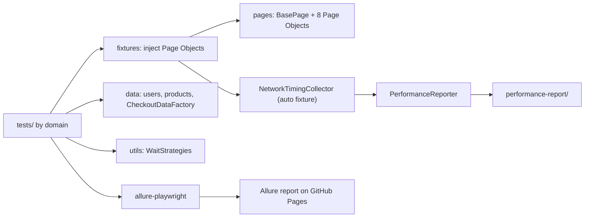

# UI Automation Framework

[](https://github.com/SDET-resplandor/ui-automation-framework/actions/workflows/playwright.yml)

End-to-end UI test automation for [SauceDemo](https://www.saucedemo.com), the public demo store built by Sauce Labs for practicing test automation. Built with **Playwright + TypeScript**, using the Page Object Model, custom fixtures, and a CI pipeline that runs every test on Chromium, Firefox and WebKit and publishes an Allure report.

**Live Allure report:** https://sdet-resplandor.github.io/ui-automation-framework/

## What this project demonstrates

- A maintainable UI framework: Page Objects, fixtures that inject them, and test data kept out of the tests.
- Design patterns used where they solve a real problem: **Strategy** (wait strategies for dynamic pages) and **Factory** (checkout data with overrides for invalid cases).
- Coverage beyond the happy path: negative login, form validation, cart edge cases, sorting, dynamic catalog pages, and a documented product defect.
- Cross-browser execution in CI, with retries and traces only where they help.
- Reporting: Allure, Playwright's HTML report, and a custom network-timing report.

## Tech stack

| Area | Tools |
|---|---|
| Test framework | Playwright (`@playwright/test` 1.63), TypeScript |
| Reporting | Allure (`allure-playwright`, `allure-commandline`), Playwright HTML report, custom performance reporter |
| CI/CD | GitHub Actions, GitHub Pages |
| Runtime | Node.js LTS (Java is required only to generate the Allure report locally) |

## Architecture



### Project structure

```
.github/workflows/playwright.yml   CI: test, report, publish
src/
  data/        users, products, CheckoutDataFactory
  fixtures/    custom test with Page Objects injected
  pages/       BasePage + 8 Page Objects
  reporters/   PerformanceReporter
  utils/       WaitStrategies, NetworkTimingCollector
tests/
  auth/        invalid login scenarios
  catalog/     sorting and dynamic catalog
  checkout/    cart edge cases and form validation
  e2e/         happy path, smoke, known defect
playwright.config.ts
```

## Test coverage

24 test cases, 72 executions per run (each test runs on 3 browsers).

| Area | Tests | What is covered |
|---|---|---|
| Login (negative) | 7 | Locked-out user, wrong password, unknown user, empty fields, access without a session, slow login (`performance_glitch_user`) |
| Product sorting | 4 | Price low-high / high-low, name A-Z / Z-A |
| Dynamic catalog | 3 | Lazy-load growth across batches, spinner page with randomized delay |
| Cart | 2 | Cart badge while adding/removing, cancel returning to the cart |
| Checkout validation | 4 | Missing first name, last name, postal code; names with special characters |
| E2E happy path | 1 | Login, add to cart, checkout, confirmation, order PDF download |
| Smoke | 1 | Login and products page |
| `problem_user` | 2 | Login precondition, plus the image defect (see below) |

Tests are tagged `@smoke` (2) and `@regression` (22).

### Scope and limits

- Users covered: `standard_user`, `locked_out_user`, `problem_user`, `performance_glitch_user`. Not covered: `error_user`, `visual_user`.
- The Slider page of the Dynamic Catalog and visual regression testing are out of scope by design.
- The suite depends on a public third-party site. Network or site problems can produce failures that are not defects in the tests (see Stability).

### Known defect

`problem_user` renders the same image for every product. The test asserts the correct behavior and is marked with `test.fail`, so the build stays green while the defect exists and turns red if the site fixes it. A separate precondition test checks that `problem_user` can log in and reach the catalog, so an unrelated failure cannot hide behind the expected one.

## Design decisions

- **Fixtures inject Page Objects.** Tests receive `loginPage`, `productsPage`, etc. instead of instantiating them, which removes repeated setup.
- **Strategy for waits.** `ScrollUntilCountIncreasesStrategy` and `WaitForExpectedCountStrategy` encapsulate how each dynamic page is awaited.
- **Factory with overrides.** `CheckoutDataFactory.validUser({ firstName: '' })` builds invalid cases from one valid baseline.
- **WebKit form stability.** In WebKit a re-render was clearing checkout fields, so `fillUserInformation` verifies the values and retries the fill with `expect(...).toPass()`.
- **Spinner page.** It renders more items than first assumed, so the test asserts a minimum count instead of an exact one.
- **Per-test downloads.** The order PDF is saved with `testInfo.outputPath`, which avoids collisions between parallel runs.
- **Credentials in one place.** SauceDemo's password is public, so centralizing it in `src/data/users.ts` is about avoiding duplication, not secrecy. It can be overridden with `SAUCE_PASSWORD`.

## Getting started

Requirements: Node.js LTS. Java is needed only to generate the Allure report locally.

```bash
git clone https://github.com/SDET-resplandor/ui-automation-framework.git
cd ui-automation-framework
npm ci
npx playwright install --with-deps   # on Windows: npx playwright install
```

### Run the tests

```bash
npm test                                  # all tests, all browsers
npm run test:smoke                        # only @smoke
npx playwright test --project=chromium    # a single browser
npx playwright test --grep @regression    # only @regression
npx playwright show-report                # Playwright HTML report
```

### Allure report

```bash
npm run test:report    # clean, run tests, generate report
npm run allure:open    # open allure-report in the browser
```

## CI/CD

The workflow in `.github/workflows/playwright.yml` runs on every push and pull request to `main`: install dependencies and browsers, run the full suite on 3 browsers, generate the Allure report, and upload the reports as a build artifact. On pushes to `main` it also publishes the Allure report to GitHub Pages. In CI, failed tests are retried twice, traces are kept on the first retry, and screenshots are kept on failure.

## Network performance report

A fixture measures every request to `saucedemo.com` during each test, and `PerformanceReporter` writes `performance-report/network-performance.md` and `.json` (also added to the GitHub Actions job summary). It reports average, p95 and max times overall, per browser, and per test, plus the 10 slowest requests. HTTP errors, expected SPA 404 responses (direct navigation to internal routes) and aborted requests are counted separately.

The budgets are informational and never fail the run. Defaults are 1000 ms per request and 1500 ms p95 per test, adjustable with `SLOW_REQUEST_MS` and `P95_BUDGET_MS`. These numbers come from a CI runner against a third-party demo site, so they are useful for spotting trends and anomalies, not as a load test or as a measure of the site's real performance.

## Stability

Measured on the final code of this release (before this README was added) on a stable network, with `npx playwright test --repeat-each=5 --retries=0` (24 tests x 3 browsers x 5 repeats = 360 executions):

| Result | Count |
|---|---|
| Executions | 360 |
| Passed | 360 (includes 15 expected failures of the known `problem_user` defect, which `test.fail` reports as passed) |
| Failed | 0 |

**Known intermittent failure.** The E2E happy path on Firefox sometimes times out waiting for the `download` event of the order PDF (`page.waitForEvent('download')`). Across four runs it failed 3 times in 60 Firefox executions: 2 of 5 in an earlier full run, 0 of 5 in the final full run, 1 of 20 when run in isolation with a single worker, and 0 of 30 in a later isolated run with tracing enabled. It did not fail on Chromium or WebKit in these runs. The failure could not be reproduced on demand and its cause has not been confirmed. In CI, failed tests are retried up to twice.

## Development process

Built in 8 user stories over a two-week sprint, tracked as GitHub issues, with one commit per story.

| Story | Title | Date |
|---|---|---|
| [US-01](https://github.com/SDET-resplandor/ui-automation-framework/issues/1) | Sprint Planning & Environment Setup | Oct 1, 2026 |
| [US-02](https://github.com/SDET-resplandor/ui-automation-framework/issues/2) | Initialize Playwright Project & Page Object Model Foundation | Oct 3, 2026 |
| [US-03](https://github.com/SDET-resplandor/ui-automation-framework/issues/3) | Core Test Scenarios & CI/CD Pipeline | Oct 5, 2026 |
| [US-04](https://github.com/SDET-resplandor/ui-automation-framework/issues/4) | Expand Test Coverage & Design Patterns | Oct 7, 2026 |
| [US-05](https://github.com/SDET-resplandor/ui-automation-framework/issues/5) | Defect Resolution & Edge Cases | Oct 9, 2026 |
| [US-06](https://github.com/SDET-resplandor/ui-automation-framework/issues/6) | Refactor for Scalability & Maintainability | Oct 12, 2026 |
| [US-07](https://github.com/SDET-resplandor/ui-automation-framework/issues/7) | Reporting & Non-Functional | Oct 13, 2026 |
| [US-08](https://github.com/SDET-resplandor/ui-automation-framework/issues/8) | Final Evaluation, Documentation & Repository Merge | Oct 14, 2026 |

## Author

Juan Andrés Resplandor Centeno, QA Automation. [GitHub](https://github.com/SDET-resplandor)